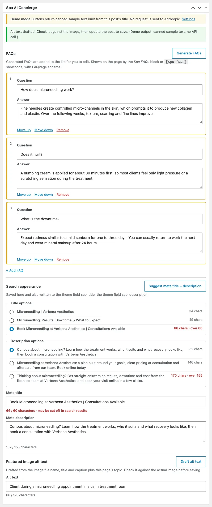
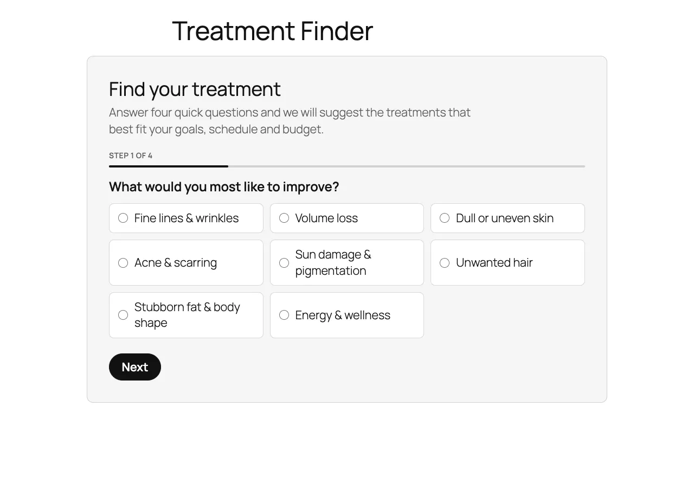
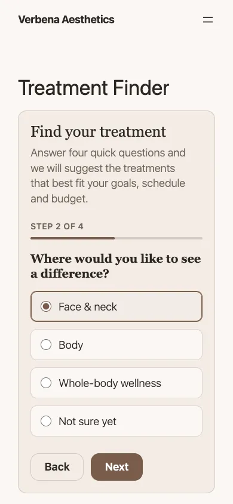
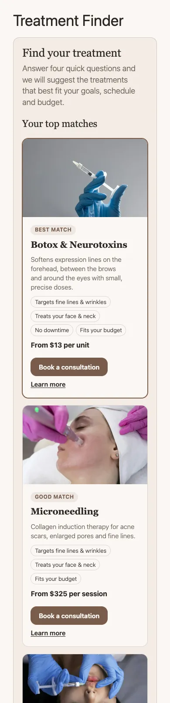
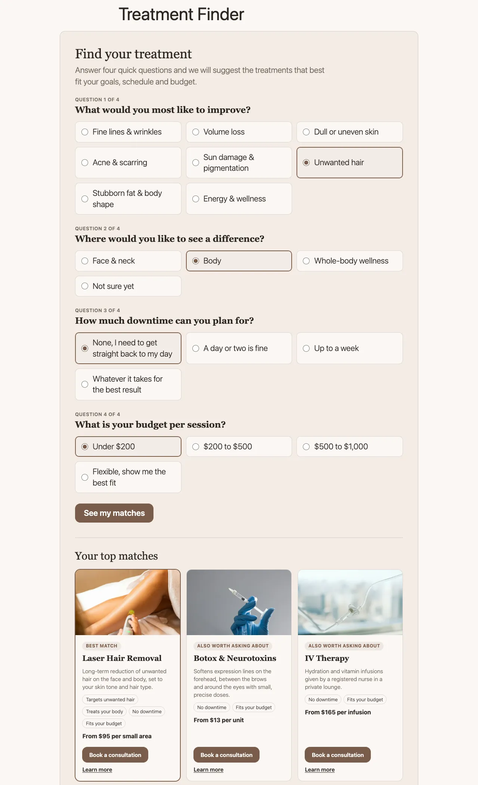

# Spa AI Concierge

A WordPress plugin for salon, spa and medspa sites. It does two jobs:

1. **Content assistant for editors.** A box on the post edit screen drafts FAQs, meta titles and descriptions, and featured-image alt text with the Anthropic Messages API. Nothing is published automatically: drafts land in form fields, the editor reviews them, and they are saved when the post is updated.
2. **Treatment Finder for visitors.** A four-question quiz (concern, area, downtime, budget) that recommends the three best-matching treatments with a "Book a consultation" button. Matching is rule-based PHP, so the public page never calls an AI service.

Live demo: https://mediumslateblue-armadillo-787648.hostingersite.com/treatment-finder/
(Demo mode is on there, so the editor buttons return sample text and cost nothing.)

Repository: https://github.com/KeronLewisGit/spa-ai-concierge

## Screenshots

| | |
|---|---|
|  |  |
| Finder results, using the theme's `--brand-*` custom properties | Editor meta box in demo mode: generated FAQs, three title and description options with character counts, drafted alt text |
|  |   |
| Same block on Twenty Twenty-Five with no theme changes | 390 px wide: one question per step, then results |
|  |  |
| JavaScript disabled: all four questions in one GET form, results rendered by PHP | Saved FAQs as a `<details>` accordion with FAQPage JSON-LD |

## Requirements

- WordPress 6.5 or newer, PHP 8.1 or newer
- An Anthropic API key for live generation (optional; demo mode works without one)
- No build step and no Composer on the server: the plugin ships its own PSR-4 autoloader

## Install

Upload `dist/spa-ai-concierge.zip` under Plugins → Add New → Upload, or copy the `spa-ai-concierge/` folder into `wp-content/plugins/` and activate it. WP-CLI: `wp plugin install spa-ai-concierge.zip --activate`.

On activation the plugin:

- creates the default **Concern** terms (fine lines & wrinkles, volume loss, dull or uneven skin, acne & scarring, sun damage & pigmentation, unwanted hair, stubborn fat & body shape, energy & wellness);
- creates a published **Treatment Finder** page at `/treatment-finder/` unless a page already contains the finder block or shortcode (if a page with that slug exists, the block is appended to it);
- fills Concern terms, areas, downtime and starting price for treatments whose titles it recognises (Botox and other neurotoxins, dermal fillers, HydraFacial, laser hair removal, chemical peels, microneedling, IV therapy, body contouring), and gives each one FAQs. Values the theme already stores (see [Theme fields](#theme-fields)) win over the built-in defaults. Existing values are never overwritten.

If the treatment post type is not registered yet, or has no posts, the seeder tries again on `init` at most once a minute until treatments appear, then records that it has finished. This covers hosts that activate plugins with WP-CLI before the theme that registers the post type. A lock in the options table stops two requests from seeding at the same time.

## Setup

Settings → Spa AI Concierge:

| Setting | Default | Notes |
|---|---|---|
| API key | none | Better in `wp-config.php`; see below. Once saved, only the last four characters are shown. |
| Model | `claude-haiku-4-5` | Any Messages API model ID. Haiku is fast and cheap, which suits short SEO copy. |
| Max output tokens | 1024 | 256 to 8192 |
| Requests per user per hour | 20 | Per-user limit on the assistant routes |
| Brand voice notes | empty | Added to every prompt |
| Demo mode | on | Always on while no key is configured |
| Treatment post type | `treatment` | Falls back to pages if the type is not registered |
| Booking URL | empty | Blank uses a published page with the slug `book`, `booking`, `book-now`, `book-a-consultation`, `consultation` or `contact`. The treatment slug is added as `?treatment=`. |
| FAQs | on | Append saved FAQs to treatment posts that do not already contain the FAQ block or shortcode |
| Uninstall | off | Also delete FAQs, finder fields and Concern terms when the plugin is deleted |

### API key

Put the key in `wp-config.php` so it never sits in the database:

```php
define( 'SPA_AI_CONCIERGE_API_KEY', 'sk-ant-...' );
```

The constant takes priority over the settings field. The key is only used server side in the `x-api-key` header; it is never printed into a page, localized into JavaScript or returned by a REST route.

### Demo mode

Demo mode returns sample output built from the post's real title (eight treatment-specific FAQ sets plus a generic set, three title and description options, alt text from the image file name or caption). It goes through the same schema validation as a live response. The meta box labels it ("Demo mode … No request is sent to Anthropic"), and every status message from a demo call ends with "(Demo output: canned sample text, no API call.)".

## Editor workflow

The **Spa AI Concierge** meta box appears on posts, pages and every public custom post type, in both the classic editor and the block editor. It sends the current, unsaved title, content and excerpt, so it works before the first save.

- **Generate FAQs** adds 4 to 6 question/answer rows to an editable list (new rows are outlined). Rows can be edited, reordered, removed or added by hand.
- **Suggest meta title + description** shows three options of each with character counts. Anything over 60 (title) or 155 (description) characters is flagged in red. Picking an option fills the field below, which keeps a live counter.
- **Draft alt text** writes alt text for the featured image from its file name, title and caption plus the page topic. It is a text-only request; the `spa_ai_concierge_user_content` filter can add an image block for a vision request.

Saving the post stores the reviewed values. Meta title and description are also written to Yoast SEO (`_yoast_wpseo_title`, `_yoast_wpseo_metadesc`) or Rank Math (`rank_math_title`, `rank_math_description`) when those plugins are active. With no SEO plugin, the plugin prints the description meta tag and sets the document title itself.

### How the API call works

`wp_remote_post` to `https://api.anthropic.com/v1/messages` with `x-api-key`, `anthropic-version: 2023-06-01` and `content-type: application/json`, a 45-second timeout and no redirects.

Each task is a single tool (`record_faqs`, `record_meta_suggestions`, `record_alt_text`) with a JSON schema, and `tool_choice` forces that tool. Models that reject a forced `tool_choice` get `tool_choice: auto` with `strict: true` on the tool instead; if an unknown model rejects the forced choice, the request is retried once in auto mode.

The response is validated in PHP (`ResponseParser` + `JsonValidator`): required keys, no extra keys, item counts, string lengths. Markup is stripped and duplicate questions are removed. A refusal, a response cut off at `max_tokens`, a missing tool call or a schema mismatch is rejected with a plain message in the meta box ("…did not match the expected format, so it was rejected. Nothing was changed."). Schema details go to the PHP error log when `WP_DEBUG` is on.

## Treatment Finder

Add it with the **Treatment Finder** block or `[spa_treatment_finder heading="…" intro="…"]`.

Each treatment is scored from its Concern terms and the **Treatment Finder** side box on the edit screen (areas, typical downtime in days, starting price):

| Rule | Points |
|---|---|
| Treats the chosen concern | +50 |
| Treats the chosen area | +20 (+10 when the visitor picked "not sure", +5 when the treatment has no area) |
| Downtime within tolerance | +20 (over tolerance: −5 per extra day, at most −30; unknown: +5) |
| Starting price within budget | +15 (over budget: −10, or −25 if more than double; unknown: +5) |

Treatments that match the concern always rank above those that do not; ties go to the lower price, then the title. The top three are shown with the reasons that matched ("No downtime", "Fits your budget") and a booking link.

- **With JavaScript** it shows one question at a time with Back/Next, moves focus to each new question, flags a missing answer with `aria-invalid`, loads results from `GET /wp-json/spa-ai-concierge/v1/finder` into an `aria-live` region, focuses the results heading and updates the URL so the result can be shared.
- **Without JavaScript** it is a plain GET form with all four fieldsets; PHP renders the same results on the next page load. If the REST request fails, the script submits the form the same way.
- If `window.dataLayer` exists it receives `finder_complete` (`finder_concern`, `finder_area`, `finder_downtime`, `finder_budget`, `finder_result_count`, `finder_results`) and `finder_book_click` (`finder_treatment`, `finder_treatment_id`).

The REST route is public and read-only, validates every parameter against a fixed list, and is limited to 30 requests a minute per visitor (keyed on a salted hash of the IP address).

### Styling

The CSS inherits the theme and reads these custom properties, falling back to block theme presets and then to neutral values:

`--brand-ink`, `--brand-bg`, `--brand-accent`, `--brand-accent-ink`, `--brand-muted`, `--brand-surface`, `--brand-radius`, `--brand-font-display`, `--brand-font-body`

On Twenty Twenty-Five it picks up the theme's contrast colour for buttons and its fonts.

## FAQs on the front end

Saved FAQs render with the **Spa FAQs** block or `[spa_faqs post_id="123" heading="Questions" open_first="1"]` as a `<details>`/`<summary>` accordion, which is keyboard accessible without any script.

When FAQs are shown, the plugin prints FAQPage JSON-LD in the footer for that post, matching the visible questions. It skips the schema when:

- the post uses the Yoast or Rank Math FAQ block, or Rank Math has FAQPage schema stored for it;
- the theme declares `add_theme_support( 'spa-ai-concierge-no-faq-schema' )`;
- `spa_ai_concierge_output_faq_schema` returns false;
- any other FAQPage (standalone, inside an `@graph`, or microdata) is found in the final HTML. The page is buffered only on singular views that have FAQs or a saved description, and the plugin removes its own script in that case. The same check removes the plugin's meta description if the theme or another plugin already printed one.

## Theme fields

Many spa themes keep FAQs in an ACF repeater and SEO text in plain fields. When a post has one of these, the plugin works with it instead of beside it:

- **FAQ repeater** (`treatment_faqs`, `service_faqs`, `faqs` or `faq`, with `question` and `answer` sub fields): the seeder imports existing rows, and saving the meta box writes the reviewed list back in ACF's storage layout, keeping the field-key references, so ACF and the theme keep reading it. FAQs are not auto-appended to those posts because the theme already shows them.
- **SEO fields** (`seo_title`/`meta_title`, `seo_description`/`meta_description`): pre-filled into the meta box and updated on save.
- **Finder data**: downtime and price are read from `downtime_days`, `downtime`, `treatment_downtime`, `recovery_time`, and `price_from`, `starting_price`, `from_price`, `price`, `treatment_price`. Free text is parsed ("1 to 3 days of redness" → 3 days, "None; avoid exercise for 24 hours" → 0, "From $350" → 350). `price_unit` is shown after the price ("From $13 per unit"). Areas fall back to terms in any other taxonomy on the post whose names mention face, body, wellness and similar words.

The field names can be changed with `spa_ai_concierge_theme_faq_fields` and `spa_ai_concierge_theme_seo_fields`.

## Security

- Assistant routes (`POST spa-ai-concierge/v1/posts/{id}/faqs|meta|alt-text`) require `edit_post` for that post in `permission_callback`. Cookie requests need the `X-WP-Nonce` header (core's `wp_rest` nonce); application passwords also work. Other users get a 401 or 403.
- An attachment ID sent for alt text is only used if it is an attachment the user can edit.
- Meta box saves check a nonce, autosave, revisions and `edit_post`. FAQ questions are `sanitize_text_field`; answers go through `wp_kses` allowing only `a`, `strong`, `em`, `br`. Settings are sanitized field by field, and the model ID must match a strict pattern.
- Per-user limit on the assistant (20 an hour by default, transients) and per-visitor limit on the finder route. Both return 429 with `retry_after`.
- All output is escaped. JSON-LD is encoded with `JSON_HEX_TAG` and `JSON_HEX_AMP`.
- Upstream API messages are never shown to editors; they are logged with `error_log` only when `WP_DEBUG` is true, and the key is never logged.

## Hooks

| Filter | Purpose |
|---|---|
| `spa_ai_concierge_demo_mode` | Force demo mode on or off |
| `spa_ai_concierge_assistant_post_types` | Post types that show the meta box |
| `spa_ai_concierge_post_context` | Context array sent to prompts and demo output |
| `spa_ai_concierge_system_prompt` | System prompt per task |
| `spa_ai_concierge_user_content` | User content blocks (add an image block for vision) |
| `spa_ai_concierge_request_timeout` | HTTP timeout in seconds (default 45) |
| `spa_ai_concierge_rate_limit` | Assistant requests per user per hour |
| `spa_ai_concierge_output_faq_schema` | Print FAQPage JSON-LD for a post |
| `spa_ai_concierge_auto_append_faqs` | Append FAQs to the post content |
| `spa_ai_concierge_output_meta_tags` | Print title/description when no SEO plugin is active |
| `spa_ai_concierge_finder_post_type` | Post type the finder reads |
| `spa_ai_concierge_treatment_data` | Per-treatment finder data (map your own fields here) |
| `spa_ai_concierge_finder_limit` | Number of recommendations (default 3) |
| `spa_ai_concierge_finder_results` | Ranked results before rendering |
| `spa_ai_concierge_booking_url` | "Book a consultation" URL |
| `spa_ai_concierge_theme_faq_fields` | Theme FAQ repeater names to read and write |
| `spa_ai_concierge_theme_seo_fields` | Theme SEO field names to read and write |

Theme support flag: `spa-ai-concierge-no-faq-schema`.

## Data stored

| Where | Key | Contents |
|---|---|---|
| Option | `spa_ai_concierge_settings` | Settings, including the API key if entered there |
| Option | `spa_ai_concierge_seeded`, `spa_ai_concierge_finder_page` | Seeder status, finder page ID |
| Option (temporary) | `spa_ai_concierge_seed_lock`, `_transient_spa_ai_concierge_seed_wait`, `_transient_spa_ai_rl_*` | Seeder lock and retry timer, rate-limit counters |
| Post meta | `_spa_ai_faqs`, `_spa_ai_faqs_source` | Reviewed FAQs and where they came from (`manual`, `ai`, `demo`, `theme`) |
| Post meta | `_spa_ai_meta_title`, `_spa_ai_meta_description` | Chosen meta title and description |
| Post meta | `_spa_ai_areas`, `_spa_ai_downtime_days`, `_spa_ai_price_from` | Finder fields |
| Taxonomy | `concern` | Concern terms on the treatment post type and pages |
| Attachment meta | `_wp_attachment_image_alt` | Alt text, when saved from the meta box |

No visitor data is stored. Uninstalling removes the options and rate-limit transients; post data is removed only if the uninstall setting is ticked.

## Development

```bash
composer install
composer test        # PHPUnit + Brain Monkey: 66 tests
composer phpcs       # WordPress Coding Standards + PHPCompatibilityWP
composer lint        # php -l on every file
scripts/package.sh   # dist/spa-ai-concierge.zip
```

Unit tests cover the response parser against recorded Messages API responses in `tests/fixtures/` (tool use, JSON in a text block, refusal, `max_tokens`, wrong shape, too few or duplicate FAQs, API error object), the JSON schema validator, the request builder (headers, forced vs. auto tool choice, strict-mode schema), the prompt builder, the finder scoring and answer normalisation, the rate limiter with a fake clock, demo output for every treatment profile, free-text downtime and price parsing, and duplicate schema removal.

### Local test site

`scripts/local-wp.sh setup` downloads WordPress into `.local-wp/` (git-ignored), installs the SQLite Database Integration drop-in so no MySQL is needed, symlinks this folder into `wp-content/plugins/` and runs the installer (admin / admin). `scripts/local-wp.sh serve` starts `php -S 127.0.0.1:8141`.

## Credits

Built by [Keron Lewis](https://keronlewis.dev). Text generation by the [Anthropic Messages API](https://docs.anthropic.com/en/api/messages). Testing with PHPUnit and Brain Monkey; coding standards by WPCS. Treatment photos in the screenshots are from the Verbena demo theme.

License: GPL-2.0-or-later.
